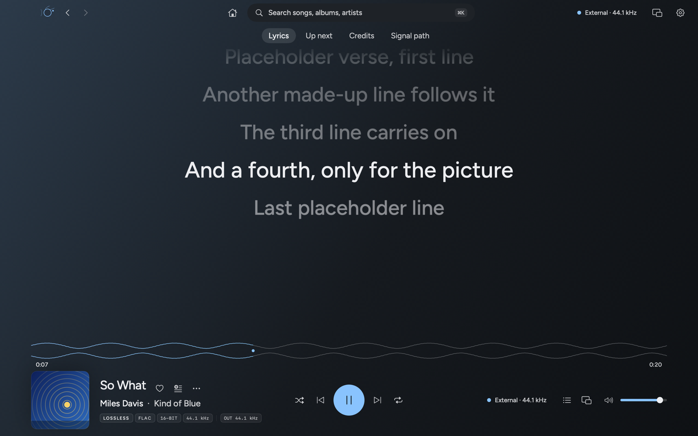
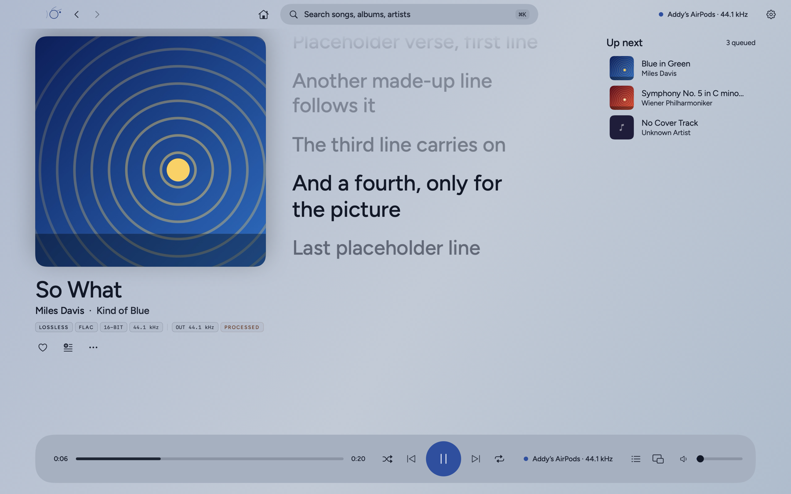
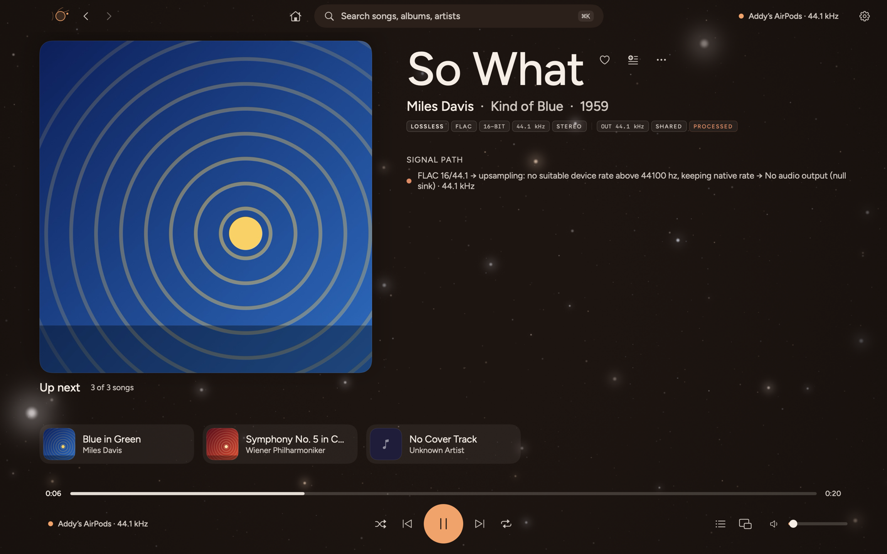
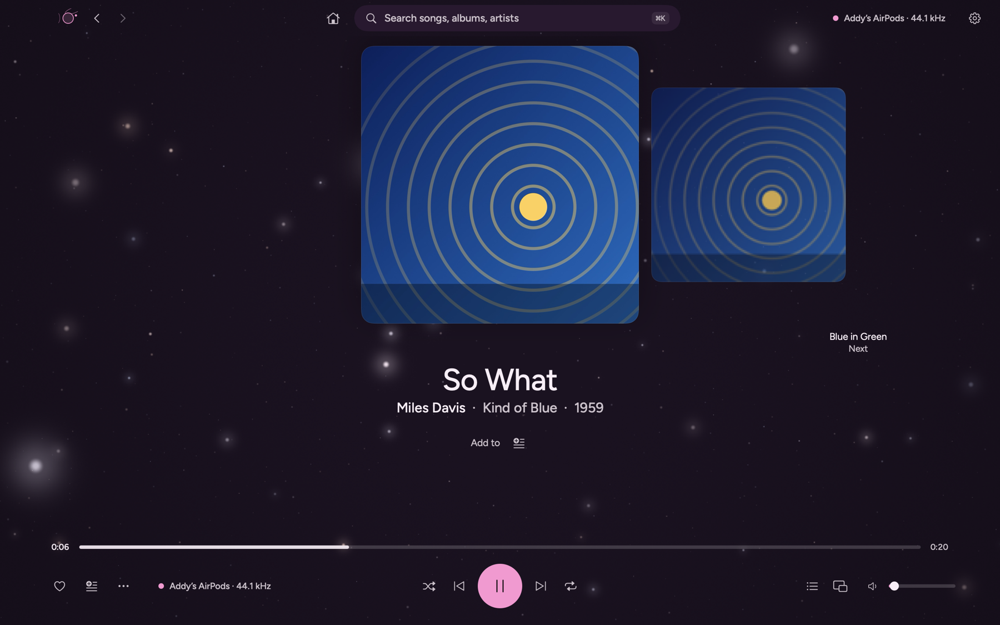
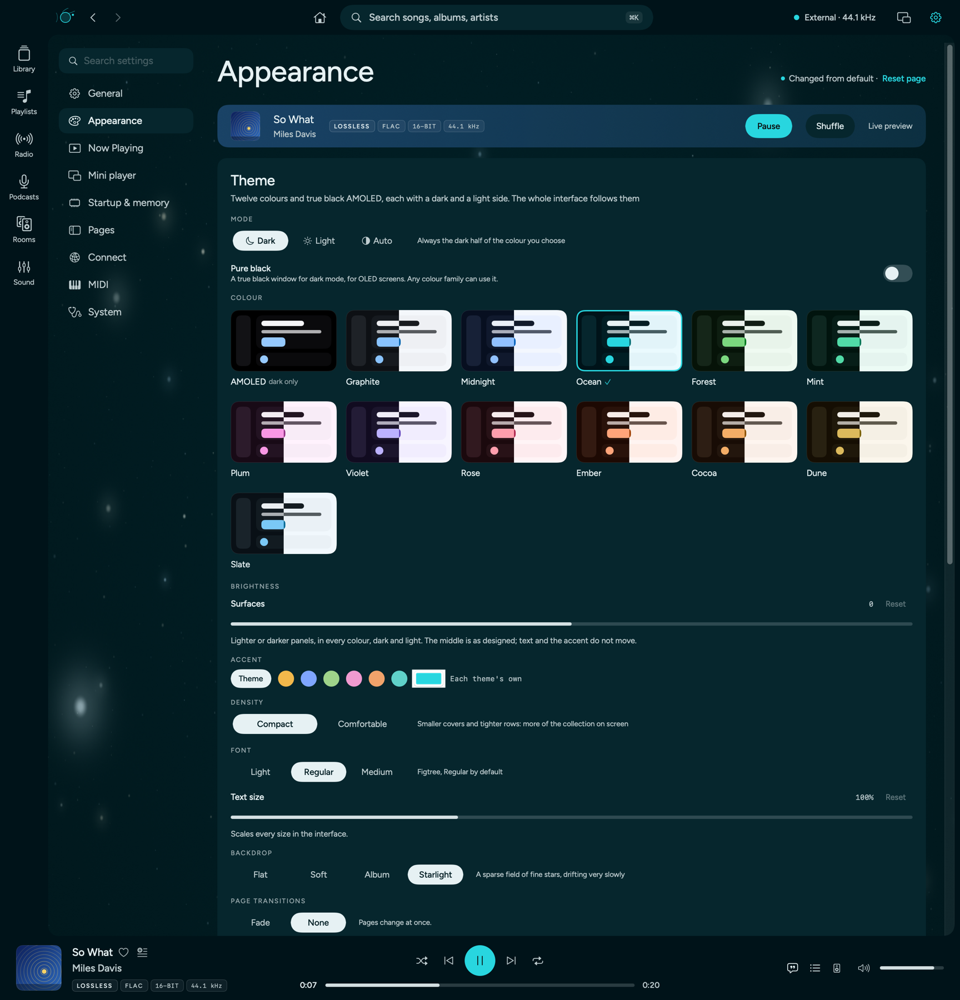
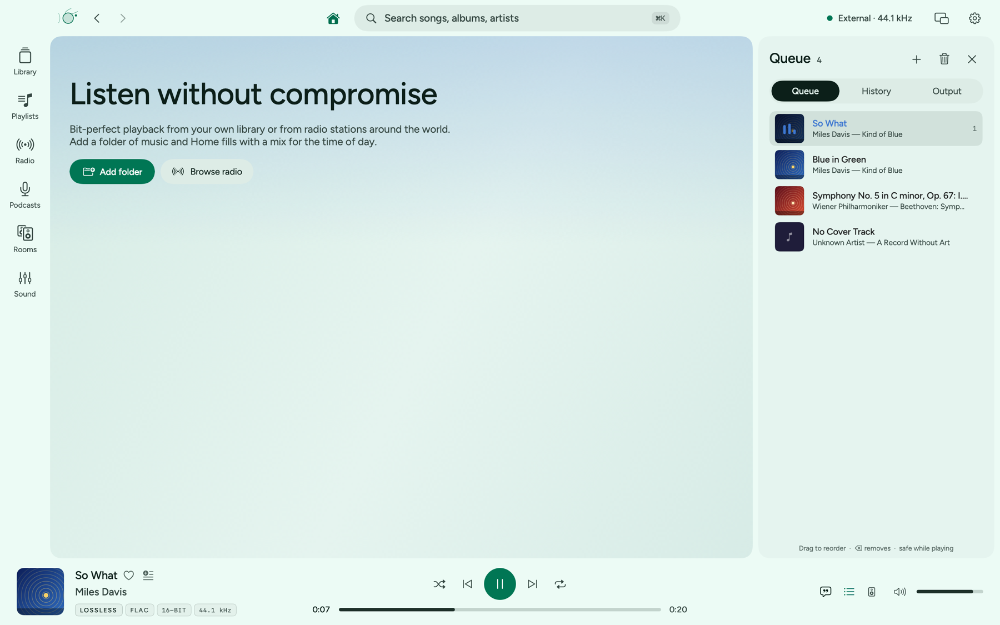
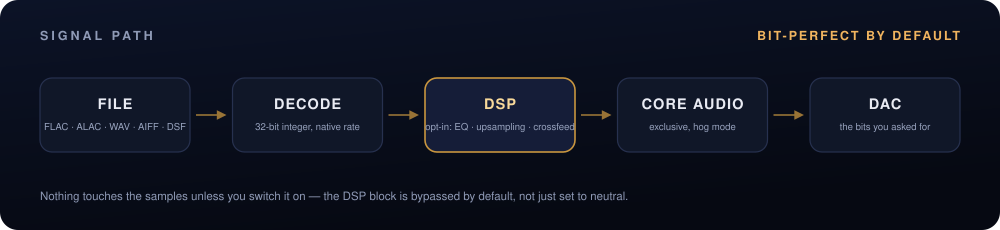

<div align="center">


<br/>

[](https://github.com/retrohog/Aureon/releases/latest)


[](Package.swift)
[](LICENSE)



</div>

**Aureon is a native macOS music player that does not touch your files on the way to the DAC.** Tracks are decoded at
their own sample rate and bit depth into 32-bit integers, a lock-free ring buffer feeds the DAC callback, and the
signal-path view shows every stage in the chain. Upsampling, EQ, crossfeed, room correction and DSD are there when you
switch them on; when they are off they are out of the path, not set to neutral.

> **Status: early (0.4).** What could not be verified without
> special hardware, accounts or signing is listed under [Known issues](#known-issues) and [Not verified](#not-verified-on-real-hardware-or-accounts).
>
> **Platforms:** 0.4.0 runs on **Apple Silicon and Intel Macs, macOS 15 or later**. The Windows version follows separately. The app is not notarised
> yet, so the first launch needs right-click → **Open**.

<br/>

## Highlights

|  |  |  |
|:--|:--|:--|
| **Bit-perfect by default**<br/>FLAC, ALAC, WAV and AIFF at their native rate and depth, gapless, with exclusive mode and automatic rate switching. | **Sound shaping, opt-in**<br/>Sinc upsampling, PCM→DSD up to DSD512, EQ, AutoEQ, crossfeed, room correction and dither. | **Signal path**<br/>Shows every stage, and marks the first one that changes a sample. |
| **New interface**<br/>Thirteen colours in dark and light, with a true-black AMOLED, six Now Playing layouts, a mini player and a menu bar player. | **Speaker levelling**<br/>Each output gets a job, a level and a delay, and the levels follow the volume. | **DJ console**<br/>Two decks, BPM and key detection, loops, hot cues, effects, crossfader, headphone cue and MIDI controllers. |

<br/>

## What's new in 0.4.0

| | |
|:--|:--|
| **New design** | A new shell with a search bar, an output chip and a rail of six places (Library, Playlists, Radio, Podcasts, Rooms, Sound). Set in Figtree, with Compact and Comfortable density. |
| **Colours** | A true-black **AMOLED** and twelve colours (Graphite, Midnight, Ocean, Forest, Mint, Plum, Violet, Rose, Ember, Cocoa, Dune, Slate), each in dark and light. **Dark**, **Light** or **Auto** (follows macOS), a **Pure black** switch, one **Brightness** slider, any accent colour, and the Starlight backdrop. |
| **Now Playing** | Six layouts (Stage, Classic, Full-bleed, Carousel, Lumen, Chillax) with the transport, seek bar, queue and volume always in view. Add to playlist, credits, large synced lyrics. |
| **Mini player** | A floating player in four forms, dragged from anywhere on it, that takes the place of the main window, and a menu bar player with a popover. |
| **Memory** | Reopens with your queue, song and position, page, window place on each display, output, theme and layout. |
| **Home and Folders** | A Home that follows the time of day, and a Folders page that can remove a library folder safely. |
| **Queue** | Queue, History and Output in one panel. |

The full list, with fixes, is in the [release notes](RELEASE-NOTES-0.4.0.md).

<br/>

## Screenshots

<table>
<tr>
<td width="50%"><br/><sub><b>Stage.</b> Large synced lyrics, the waveform and the song at the foot.</sub></td>
<td width="50%"><br/><sub><b>Lumen, on the light side of Midnight.</b> Every colour has a dark and a light side.</sub></td>
</tr>
<tr>
<td width="50%"><br/><sub><b>Chillax.</b> A large cover, the signal path and the queue as a shelf.</sub></td>
<td width="50%"><br/><sub><b>Carousel.</b> The cover among its neighbours.</sub></td>
</tr>
<tr>
<td width="50%"><br/><sub><b>Appearance.</b> Dark, Light or Auto, Pure black, AMOLED and twelve colours shown in both halves, and one brightness slider.</sub></td>
<td width="50%"><br/><sub><b>Queue.</b> With History and Output beside it.</sub></td>
</tr>
</table>

<br/>

## Signal path



With processing off the path is *decoder → lock-free ring buffer → DAC callback* and nothing else touches the samples. With
DSP on, the callback pulls from an `AVAudioEngine` in manual-rendering mode. The audio render thread allocates nothing,
takes no locks and sends no Swift or Objective-C messages. See [Docs/ARCHITECTURE.md](Docs/ARCHITECTURE.md).

<br/>

## Features

### Playback and audio engine

| | |
|:--|:--|
| **Lossless playback** | FLAC, ALAC, WAV and AIFF decode to 32-bit integers. Gapless between tracks of one format; the device clock follows each track. |
| **DSD** | DSF and DFF play as **DoP** (bits untouched, markers continue across tracks) or convert to PCM. DSD up to 1024 decodes faster than real time. |
| **Transitions** | Gapless by default. Choose **crossfade** (1–12 s) or transitions that skip silence, keep existing fades and match loudness. Albums stay gapless. |
| **Memory playback** | Whole tracks load into RAM first, so playback does no disk reads. |
| **Loudness** | ReplayGain from tags, plus EBU R128 / ITU-R BS.1770-4 loudness, range, true peak and DR measured once and cached. |
| **Multichannel** | 5.1 and 7.1 play at their own channel count when the device has the outputs, otherwise through an ITU-R BS.775 downmix. |
| **Exclusive mode** | Hog mode and automatic sample-rate switching per track, with an integer physical format where the device offers one. |
| **ABX testing** | Sample-aligned, loudness-matched, double-blind trials, scored with a p-value. |

### Sound shaping

| | |
|:--|:--|
| **Upsampling** | A native polyphase sinc resampler for any rational ratio, with four oversampling filters (linear phase, minimum phase, apodizing, brickwall) that change live. |
| **PCM → DSD** | Turns any music into DSD64–DSD512 for a DoP DAC: your filter, half-band interpolation, then a 5th or 7th-order noise-shaping modulator. Off by default. [Details](Docs/DSD-OUTPUT.md) |
| **EQ and correction** | 10-band parametric EQ, AutoEQ headphone profiles, BS2B crossfeed, partitioned-FFT room correction from REW impulse responses, Audio Unit plug-ins. |
| **Dither** | TPDF and noise-shaped dither for the last bits. |

### Now Playing and interface

| | |
|:--|:--|
| **Shell** | A search bar (⌘K reaches every page and main action), the output chip, the mini player button and Settings across the top, and a rail of six places: Library, Playlists, Radio, Podcasts, Rooms and Sound. A quick control panel opens from the output chip (⌥⌘D); every pop-up opens inside the window and never over its edge. |
| **Colours** | A true-black **AMOLED** and twelve families (Graphite, Midnight, Ocean, Forest, Mint, Plum, Violet, Rose, Ember, Cocoa, Dune, Slate), each with a dark and a light side. **Dark**, **Light** or **Auto**, **Pure black** for any dark side, one **Brightness** slider that lightens or darkens the surfaces in every colour (text and accent stay put), and any accent colour. |
| **Backdrops** | Flat, Soft, **Album** (colours from the playing cover, at Subtle, Rich or Vivid) and **Starlight**, a field of fine stars with settings for intensity, motion, shooting stars and twinkle. |
| **Type** | Figtree, bundled with its licence, in Light, Regular or Medium, with a text size from 85 % to 130 %, and Compact or Comfortable density. |
| **Now Playing** | Six layouts with a preview of each in Settings: Stage, Classic, Full-bleed, Carousel, Lumen and Chillax. The transport, seek bar, queue, mini player, volume and output chip stay in view at every window size, and a setting lets them rest after a few seconds. The seek bar can be the layout's own, a waveform or a line, everywhere. |
| **Lyrics** | Large, time-synced lines in every layout, from a `.lrc` file, the file's tags or LRCLIB. Their size and ±2 s timing are in Settings. |
| **Song details** | Add to playlist, credits under the artist, format tags (Lossless, FLAC, 24-bit, rates, shared or exclusive) and the signal path. |
| **Mini player** | Four forms: a bar, a strip, a card and a menu bar popover. Dragged from the cover, the names or any empty space, and kept wholly on a screen; its place is remembered for each display. Opening it puts the main window away. |
| **Menu bar** | The logo, the logo and title, or the title; a popover that opens on a click or on hover and closes by itself. |
| **Home** | Follows the part of the day, with quick picks and shelves chosen on your Mac from what you play. |
| **Queue** | Queue, History and Output tabs. |
| **Memory** | Reopens with your queue, song and place in it, page, scroll position, window place on each display, output, theme and layout. Choose Paused, Playing, Ask me or Start fresh. |
| **Waveform and analyser** | The waveform keeps its contrast on every theme and marks each seek; the analyser shows spectrum, spectrogram and levels together. |
| **Settings for motion** | Fade or no page transitions, a launch animation you can turn off, and Reduce Motion is honoured. |

### Library and metadata

| | |
|:--|:--|
| **Library** | A Core Data library with classical-aware tags (composer, work, movement, conductor, ensemble, soloists), kept current by file-system events with no rescan at start-up. |
| **Folders** | Browse the disk as it is, with no import. Safe with symbolic links. |
| **Tag editor** | Atomic, bulk editing of FLAC, ALAC/AAC and MP3 tags, ReplayGain included. It never touches a file that is playing. |
| **Search** | A small documented query language: `Genre: Jazz AND Year: 1955..1965 NOT Artist: "Miles Davis"`. |
| **Credits graph** | Pick a person and see every record they worked on, in what role and with whom. |
| **Lyrics** | Time-synced with word highlighting, from a `.lrc` file, the file's tags or LRCLIB, with a ±2 s offset. |
| **Duplicates** | Finds songs and albums you have twice, recommends the best copy, and moves the rest to the Trash only after you confirm. |
| **Deep Dive** | Identify untagged files (AcoustID), then MusicBrainz credits, Wikipedia biographies and cover art. |
| **Booklets** | PDFs next to an album open in a digital booklet reader. |

### Outputs, rooms and casting

| | |
|:--|:--|
| **Speaker set-up** | Several outputs at once, each with a job (stereo, left, right, centre, ambience, bass), a distance, a level and a delay. Levels follow the volume in each device's own decibel steps, and outputs are time-aligned from their reported latency. |
| **Cast and rooms** | The processed output as lossless FLAC to Chromecast and Nest speakers, multi-room zones across Sonos, DLNA and Chromecast, and the system AirPlay picker. |
| **Radio and podcasts** | Free stations worldwide, including lossless FLAC streams, optionally upsampled to the DAC's best rate. A podcast directory and RSS. |
| **Cloud and servers** | Your own Backblaze B2, S3, R2, Wasabi or MinIO bucket, Navidrome / Subsonic, and Lyrion Music Server. |

### DJ mode and MIDI

| | |
|:--|:--|
| **DJ console** | Two decks on one mixer clock: waveforms, BPM and key (Camelot) detection, pitch and bend, SYNC, quantize, hot cues, loops, rolls, a 3-band EQ with kills, sweep filter, echo / reverb / flanger / gate, crossfader curves, headphone cue and a WAV mix recorder. |
| **MIDI controllers** | CoreMIDI input with MIDI Learn, 14-bit and relative encoders, soft takeover, and presets for the Pioneer DDJ-400 and Korg nanoKONTROL2. |

### Intelligence

| | |
|:--|:--|
| **On-device features** | One master switch and a switch per feature: natural-language playlists, semantic search, DJ sets, a shuffle that learns from your listening and a remixer for the DJ console, all on the Mac. You can bring your own API key (text only, never audio). Experimental: an enhancer for lossy streams and on-device lyrics. |

### Services and tools

| | |
|:--|:--|
| **Rip and convert** | Secure CD ripping with AccurateRip and MusicBrainz; batch transcoding to AAC, Apple Lossless or FLAC. |
| **Scrobbling and presence** | Last.fm, ListenBrainz and Discord Rich Presence, with an offline retry queue. Secrets live in the Keychain. |
| **Headless and remote** | `Aureon daemon` serves JSON-RPC over WebSocket with Bonjour discovery and pairing, for a companion app. |
| **Diagnostics** | `Aureon hwdebug` tests exclusive mode, integer formats, rate switching and callback health on your DAC. |

The complete list, with what each feature has been verified against, is in [Docs/FEATURES.md](Docs/FEATURES.md).

<br/>

## Platforms

| | Status |
|:--|:--|
| **Apple Silicon Mac**, macOS 15 or later | Released: 0.4.0 (arm64 build) |
| **Intel Mac**, macOS 15 or later | Released: 0.4.0 (universal build). Features that need an M-series chip are off; not yet tested on Intel hardware |
| **Windows** | In development; follows separately |

<br/>

## Install

1. Download from the [latest release](https://github.com/retrohog/Aureon/releases/latest) and drag **Aureon** to **Applications**: **Aureon-0.4.0.dmg** for Apple Silicon, or **Aureon-0.4.0-universal.dmg** for Intel Macs (it runs on both). Each has a matching `.pkg` installer.
2. The app is not notarised yet. On first launch, right-click it and choose **Open**.
3. Allow access to your music folders when macOS asks.

**Build from source** (Swift 6 toolchain):

```bash
swift build -c release
./Packaging/make_installer.sh --pkg ~/Desktop     # builds Aureon.app, a dmg and a pkg (the number is in Packaging/VERSION)
```

`Aureon hwdebug` reports what your DAC accepts.

<br/>

## Known issues

- **Casting and multi-room streams can crash under heavy load.** The live FLAC encoder (`Cast/FLACEncoder.swift`) has an intermittent index error when audio is pushed from a zone; it is not fixed yet.
- **The app is ad-hoc signed and not notarised.** The first launch needs right-click → **Open**, and macOS can ask again for access to your music folders after an update.
- **Speaker levelling and output alignment have not been checked on every speaker.** Use each output's **Level** and **Extra delay** to finish the balance; Bluetooth speakers may need a small delay trim.
- **The Intel build has not been tested on real Intel hardware.** It has been run natively on Apple Silicon and under Rosetta only.
- **On Intel Macs, the on-device language model and the audio enhancer are unavailable** (they need an M-series chip). DJ sets and playlists use an API key instead.
- **The mini player and the menu bar player use the app's colours.** They do not have a theme of their own yet.
- **Windows is not included.** The Windows version follows separately.

### Not verified on real hardware or accounts

- **Integer mode and DoP are untested against a real USB DAC.** The built-in headphone output offers float formats only; `hwdebug` shows what your hardware accepts. DSD512 output and the MIDI presets are in the same position.
- **The privileged helper has never been registered or run as root** (it needs a signed build and your approval). Its logic has only been run against stand-in processes.
- **Casting and multi-room are verified against software speakers**, not real ones. AirPlay uses the system's route picker, so exclusive mode, rate switching and bit-perfect output do not apply.
- **Cloud storage has been run against an in-memory S3 server** that checks every signature, not a live account. DSD files cannot be streamed from a bucket or server.
- **CD ripping has been run against a simulated drive.** The IOKit read path has not run on a physical drive, and no drive-offset database is bundled.
- **Discord, Last.fm, ListenBrainz, AcoustID, MusicBrainz and artwork lookups** have been run against fakes and canned responses; you supply your own keys.
- **The headphone cue** in DJ mode has only been run with simulated devices.

<br/>

## Roadmap

| | |
|:--|:--|
| **Intel hardware checks** | Run the universal build on real Intel Macs and tune the rate planner for older models. |
| **Windows** | A native Windows 11 version of the same design. |
| **Cast encoder fix** | Remove the intermittent FLAC encoder error in casting and multi-room. |
| **Device changes** | Handle an output unplugged during playback without interrupting the queue. |
| **Notarised releases** | A signed, notarised app, so the first launch needs no right-click. |
| **Bundled models** | Ship the on-device models for the lossy-stream enhancer with the app. |
| **More layouts** | Vinyl, Hi-Fi, Orbit, Timeline and Poster layouts for Now Playing. |
| **Mini player theme** | A colour theme of its own for the mini player and the menu bar player. |
| **Beat-matched transitions** | Tempo- and key-aware transitions between queued songs, using the DJ analysis. |

<br/>

## Documentation

| | |
|:--|:--|
| [Features](Docs/FEATURES.md) | Everything the app does, grouped by area, with a verification status for each |
| [Architecture](Docs/ARCHITECTURE.md) | Pipeline, real-time rules, queue reconciliation, DSD, resampler, visualisers |
| [DSD output](Docs/DSD-OUTPUT.md) | PCM→DSD design and measurements |
| [Library](Docs/LIBRARY.md) | Schema, tag mapping, classical ontology |
| [Remote protocol](Docs/REMOTE-PROTOCOL.md) | The daemon and the companion-app protocol |
| [System optimisation](Docs/SYSTEM-OPTIMIZATION.md) | Scheduling and the privileged helper |

## Contributing

See [CONTRIBUTING.md](CONTRIBUTING.md). Most useful: a USB-DAC `hwdebug --json` report, libsoxr as an alternative resampler, TLS for the remote channel, an iOS companion app.

## Credits and licence

Built with Swift, Core Audio and SQLite. Metadata and lyrics come from MusicBrainz, AcoustID, Wikipedia and LRCLIB; the optional on-device models run through MLX and WhisperKit.

MIT. See [LICENSE](LICENSE).
