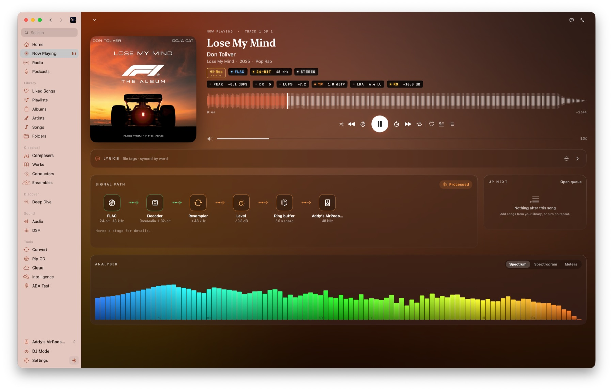
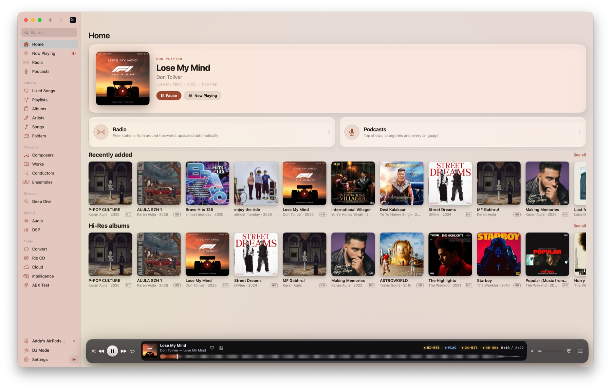
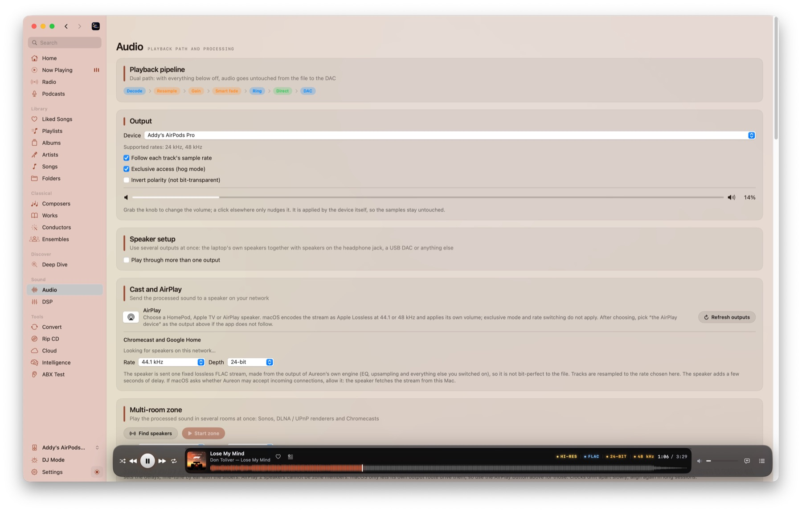
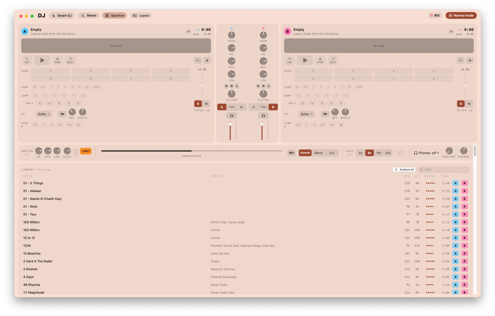
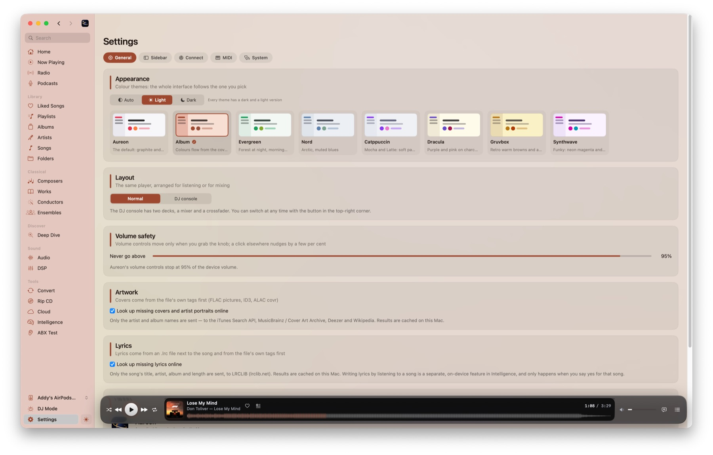

 

**Aureon is a native macOS music player for people who care about what leaves the machine.** Files are decoded at their own
sample rate and bit depth into 32-bit integers, a lock-free ring buffer feeds the DAC callback, and the signal-path view
shows exactly what is in the chain. Processing is there when you want it (upsampling, EQ, crossfeed, room correction,
DSD) but every stage is opt-in and truly bypassed when off, not merely set to neutral.

> **Status: early (0.2).** The engine and every service are covered by automated self-tests. What could not be verified
> without special hardware, accounts or signing is listed under [Limitations](#limitations). Read it before relying on
> those parts.
>
> **Download:** the 0.2.0 build is for Apple Silicon Macs. A build for Intel-based Macs will be released soon. The app is
> not notarised yet, so the first launch needs right-click → **Open**.

 

## Highlights

|  |  |  |
|:--|:--|:--|
| 🎯 **Bit-perfect by default** FLAC, ALAC, WAV and AIFF at their native rate and depth. Gapless. Exclusive mode and automatic rate switching. | 🔊 **Opt-in sound shaping** Sinc upsampling with four filters, PCM→DSD up to DSD512, EQ, AutoEQ, crossfeed, room correction, dither. | 🧭 **Always honest** The signal path turns orange at the first stage that changes a sample. You always know. |
| 🎚 **DJ console** Two decks, BPM and key detection, loops, hot cues, effects, crossfader, headphone cue, MIDI controllers. | 📚 **Serious library** Classical-aware tags, credits graph, folders, tag editor, duplicates finder, query search. | 📡 **Play anywhere** Radio, podcasts, S3-style buckets, Navidrome, Lyrion, Chromecast, Sonos, DLNA, AirPlay. |
| 🧠 **Optional Intelligence** On-device playlists, search and DJ sets. One master switch turns all of it off. | 🎨 **Eight themes, light and dark** Including *Album*, which takes its colours from the cover that is playing. | 🧪 **Tested without hardware** Self-tests play real files through the real player and check the delivered samples. |

 

## A look inside

<table>
<tr>
<td width="50%"> <b>Home.</b> Recently added, Hi-Res albums, Radio and Podcasts.</td>
<td width="50%"> <b>Audio.</b> Output device, exclusive mode, rate following, cast and multi-room.</td>
</tr>
<tr>
<td width="50%"> <b>DJ console.</b> Two decks, mixer, effects and an analysed library browser.</td>
<td width="50%"> <b>Themes.</b> Eight themes, each in light and dark.</td>
</tr>
</table>

 

## Signal path

With processing off the path is *decoder → lock-free ring buffer → DAC callback* and nothing else touches the samples.
With DSP on, the callback pulls from an `AVAudioEngine` in manual-rendering mode. The audio render thread allocates
nothing, takes no locks and sends no Swift or Objective-C messages. See [Docs/ARCHITECTURE.md](Docs/ARCHITECTURE.md).

 

## Features

### Playback and sound

| | |
|:--|:--|
| **Lossless playback** | FLAC, ALAC, WAV, AIFF into 32-bit integers. Gapless between tracks of the same format; the device clock follows each track. |
| **DSD** | DSF and DFF with **DoP** (bits untouched, marker continues across tracks) or conversion to PCM. Up to DSD1024 decimated faster than real time. |
| **PCM → DSD** | Any music as DSD64–DSD512 for a DoP DAC: your chosen filter, half-band interpolation, then a 5th or 7th-order noise-shaping modulator. Off by default. [Details](Docs/DSD-OUTPUT.md) |
| **Upsampling** | Native polyphase sinc resampler, any rational ratio, no dependencies. Four oversampling filters (linear phase, minimum phase, apodizing, brickwall) that can be changed live. |
| **Transitions** | Gapless by default. Optional **crossfade** (1–12 s) or **Smart** transitions that skip silence, keep existing fades and match loudness. Albums stay gapless. |
| **Memory playback** | Whole tracks decoded into RAM first; zero disk reads during playback, asserted by a test. |
| **Loudness** | ReplayGain from tags; EBU R128 / ITU-R BS.1770-4 loudness, LRA, true peak and DR measured and cached. |
| **Multichannel** | 5.1 and 7.1 at their own channel count when the device has the outputs, otherwise an ITU-R BS.775 downmix. |
| **EQ and correction** | 10-band parametric EQ, AutoEQ headphone profiles, BS2B crossfeed, partitioned-FFT room correction from REW impulse responses, Audio Unit plug-ins, TPDF and noise-shaped dither. |
| **ABX testing** | Sample-aligned, loudness-matched, double-blind trials scored with a p-value. |

### Library and metadata

| | |
|:--|:--|
| **Library** | Core Data library with classical-aware tags (composer, work, movement, conductor, ensemble, soloists). Always current through file-system events, no rescan at start-up. |
| **Folders** | Browse the disk as it is, no import needed. Safe with symbolic links. |
| **Tag editor** | Atomic, bulk editing of FLAC, ALAC/AAC and MP3 tags, ReplayGain included. Never touches a file that is playing. |
| **Search** | A small documented query language: `Genre: Jazz AND Year: 1955..1965 NOT Artist: "Miles Davis"`. |
| **Credits graph** | Pick any person and see every record they worked on, in what role, and with whom. |
| **Lyrics** | Time-synced, word-by-word highlighting. Sources: `.lrc` file, the file's tags, then LRCLIB. |
| **Duplicates** | Finds songs and albums you have twice, recommends the best copy, and moves the rest to the Trash only after you confirm. |
| **Deep Dive** | Identify untagged files (AcoustID), then MusicBrainz credits, Wikipedia biographies and cover art. |
| **Booklets** | PDFs next to an album open in a digital booklet reader. |

### DJ, MIDI and Intelligence

| | |
|:--|:--|
| **DJ console** | Two decks on one mixer clock: waveforms, BPM and key (Camelot) detection, pitch and pitch bend, SYNC and beat sync, quantize, hot cues, loops, rolls, a 3-band EQ with kills, sweep filter, echo / reverb / flanger / gate, crossfader curves, headphone cue and a WAV mix recorder. |
| **MIDI controllers** | CoreMIDI input with MIDI Learn, 14-bit and relative encoders, soft takeover and presets for the Pioneer DDJ-400 and Korg nanoKONTROL2. |
| **Intelligence** | One master switch for every AI feature, with a switch per feature. Natural-language playlists, semantic search, Smart DJ sets, Smart Shuffle and a DJ remixer, all on device. Optionally bring your own API key (text only, never audio). Experimental: a neural enhancer for lossy streams and on-device lyrics. |

### Sources and outputs

| | |
|:--|:--|
| **Radio and podcasts** | Free stations worldwide (including lossless FLAC streams), upscaled to the DAC's best rate if you like. Podcast directory and RSS. |
| **Cloud and servers** | Your own Backblaze B2, S3, R2, Wasabi or MinIO bucket, Navidrome / Subsonic, and Lyrion Music Server. |
| **Cast and rooms** | The processed output sent as lossless FLAC to Chromecast and Nest speakers, multi-room zones across Sonos, DLNA and Chromecast, and the system AirPlay picker. |
| **Rip and convert** | Secure CD ripping with AccurateRip and MusicBrainz; batch transcoding to AAC, Apple Lossless or FLAC. |
| **Scrobbling and presence** | Last.fm, ListenBrainz and Discord Rich Presence, with an offline retry queue. Secrets live in the Keychain. |
| **Headless and remote** | `Aureon daemon` serves JSON-RPC over WebSocket with Bonjour discovery and pairing, for a companion app. |
| **Diagnostics** | `Aureon hwdebug` tests exclusive mode, integer formats, rate switching and callback health on your DAC. |

The complete list, with what each feature has been verified against, is in [Docs/FEATURES.md](Docs/FEATURES.md).

 

## Documentation

| | |
|:--|:--|
| [Features](Docs/FEATURES.md) | Everything the app does, grouped by area, with a verification status for each |
| [Architecture](Docs/ARCHITECTURE.md) | Pipeline, real-time rules, queue reconciliation, DSD, resampler, visualisers |
| [DSD output](Docs/DSD-OUTPUT.md) | PCM→DSD design and measurements |
| [Library](Docs/LIBRARY.md) | Schema, tag mapping, classical ontology |
| [Remote protocol](Docs/REMOTE-PROTOCOL.md) | The daemon and the companion-app protocol |
| [System optimisation](Docs/SYSTEM-OPTIMIZATION.md) | Scheduling and the privileged helper |

 

## Limitations

An honest list of what is **not verified** or **not built**.

<b>Known issue in 0.2.0</b>

- **Closing Now Playing with the chevron can leave part of the window unresponsive.** The chevron is at the top left of the
  Now Playing page; afterwards parts of the window, including the sidebar, may stop reacting to clicks. No workaround yet.
  It is the first thing we will fix in 0.2.1.

<b>Not verified on real hardware or accounts</b>

- **Integer mode and DoP are untested against a real USB DAC.** The built-in headphone output offers float formats only; `hwdebug` tells you what your hardware accepts. DSD512 output and the MIDI presets are in the same position.
- **The privileged helper has never been registered or run as root** (it needs a signed build and your approval). Its logic is tested against stand-in processes; do the supervised first run described in its doc.
- **Casting and multi-room are verified against software speakers**, not real ones. AirPlay uses the system's own route picker, so exclusive mode, rate switching and bit-perfect output do not apply.
- **Cloud storage is tested against an in-memory S3 server** that verifies every signature, not against a live Backblaze or AWS account. DSD files cannot be streamed from a bucket or server.
- **CD ripping is tested against a simulated drive.** The IOKit read path has not run on a physical drive. No drive-offset database is bundled: enter your drive's offset.
- **Discord, Last.fm, ListenBrainz, AcoustID, MusicBrainz and artwork lookups** are tested against fakes and canned responses; you supply your own keys.
- **The headphone cue** in DJ mode is tested with simulated devices only.

<b>Roadmap</b>

Planned for upcoming releases:

| | |
|:--|:--|
| 🍎 **Intel build** | A build for Intel-based Macs. |
| ✅ **Notarised releases** | A signed, notarised app so the first launch needs no right-click. |
| 🔀 **Beat-matched transitions** | Tempo- and key-aware transitions between queued songs, using the DJ analysis. |
| 🎚 **DJ extras** | Keylock, scratching, MIDI output and LED feedback for controllers. |
| 📱 **Companion app** | An iOS app built on the included remote protocol, with an encrypted channel. |
| 🎙 **Podcasts** | Streaming start, an episode queue and resume position. |
| 📻 **More radio** | HLS and Ogg/Opus stations. |
| 🔬 **Real-hardware verification** | USB DAC integer mode and DoP, DSD512, CD drives, Chromecast and Sonos, and the MIDI presets. |
| 🧮 **libsoxr resampler** | An optional alternative to the native resampler. |

## Contributing

See [CONTRIBUTING.md](CONTRIBUTING.md). Most valuable: a USB-DAC `hwdebug --json` report, libsoxr as an alternative resampler,
TLS for the remote channel, an iOS companion app.

## License

MIT. See [LICENSE](LICENSE).
