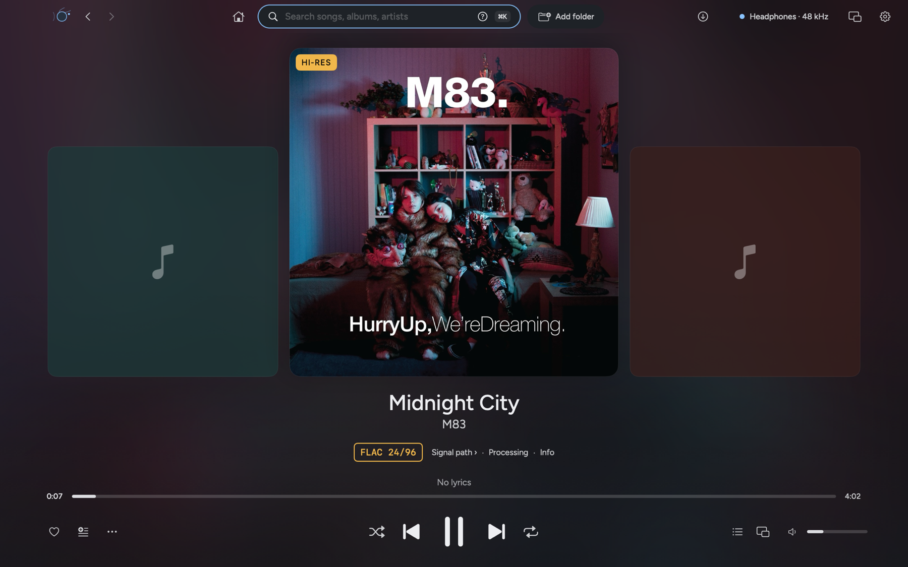
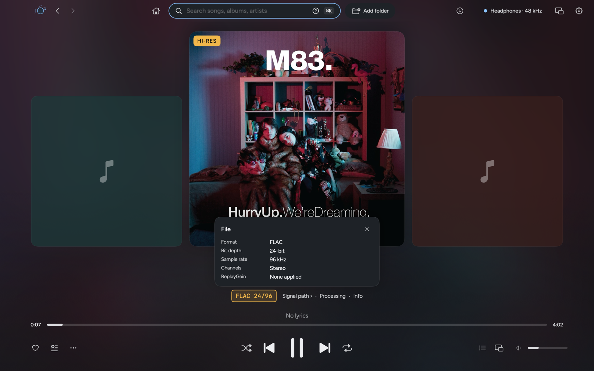
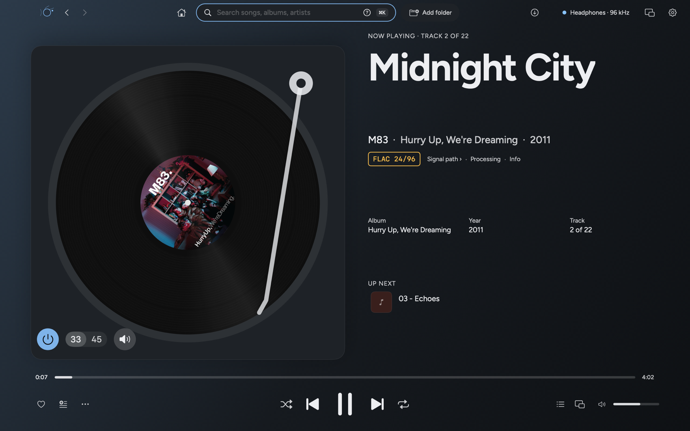
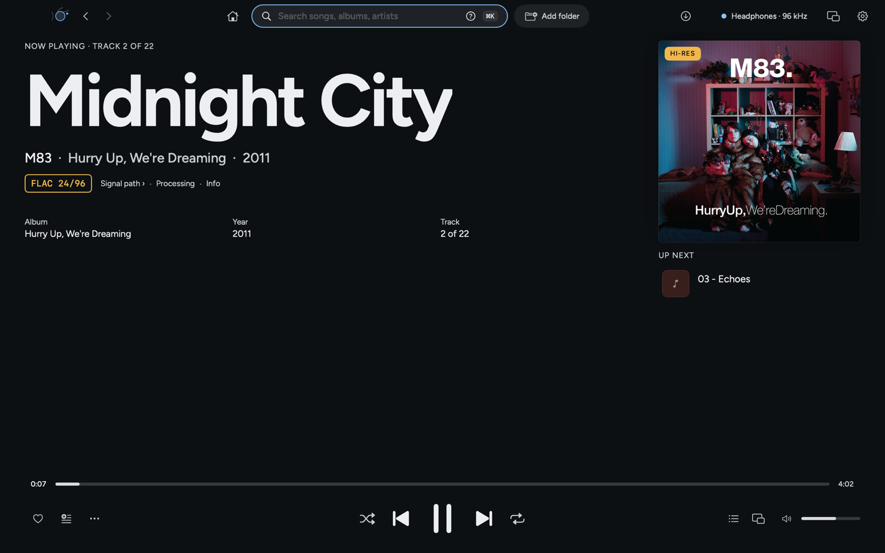
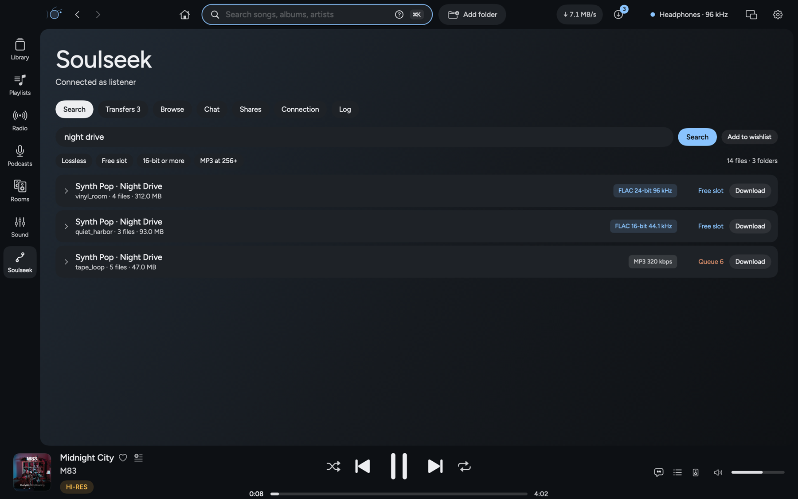
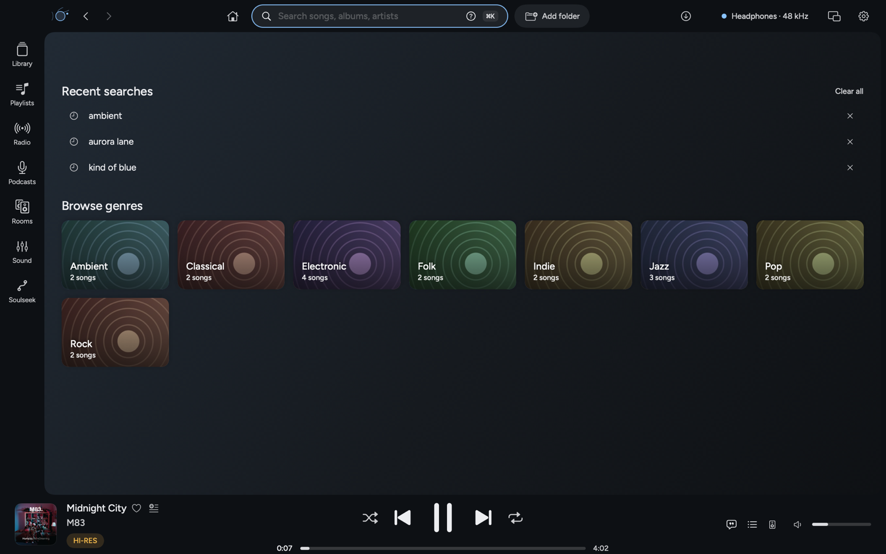
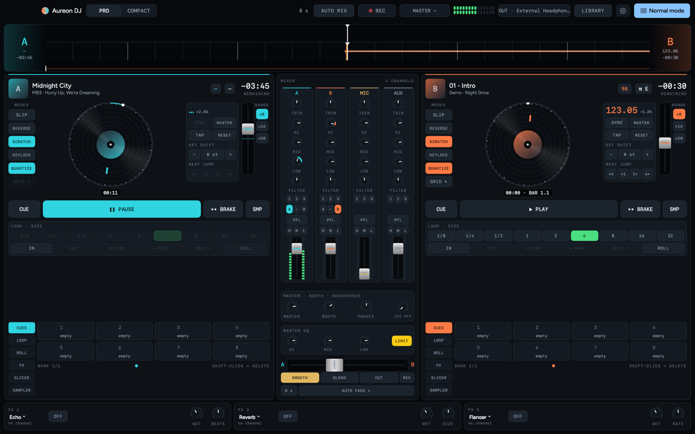
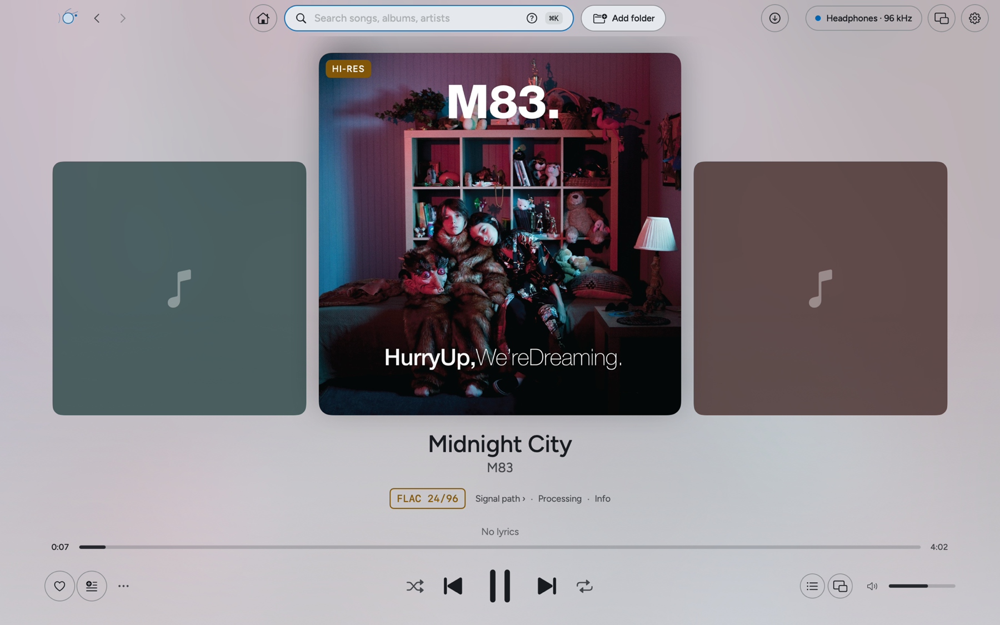

<div align="center">


<br/>

[](https://github.com/retrohog/Aureon/releases/latest)


[](Package.swift)
[](LICENSE)



</div>

**Aureon is a native macOS music player that does not touch your files on the way to the DAC.** Tracks are decoded at
their own sample rate and bit depth into 32-bit integers, a lock-free ring buffer feeds the DAC callback, and the
signal-path view shows every stage in the chain. Upsampling, EQ, crossfeed, room correction and DSD are there when you
switch them on; when they are off they are out of the path, not set to neutral.

> **Status: early (0.5).** What could not be verified without special hardware, accounts or signing is listed under
> [Known issues](#known-issues) and [Not verified](#not-verified-on-real-hardware-or-accounts).
>
> **Platforms:** 0.5.0 runs on **Apple Silicon and Intel Macs, macOS 13 Ventura or later**. The Windows version follows
> separately. The app is not notarised yet, so the first launch needs right-click → **Open**.

<br/>

## Highlights

|  |  |  |
|:--|:--|:--|
| **Bit-perfect by default**<br/>FLAC, ALAC, WAV and AIFF at their native rate and depth, gapless, with exclusive mode and automatic rate switching. | **Sound shaping, opt-in**<br/>Sinc upsampling, PCM→DSD up to DSD512, EQ, AutoEQ, crossfeed, room correction and dither. | **Signal path**<br/>Shows every stage, and marks the first one that changes a sample. |
| **Soulseek, built in**<br/>Search, download and share from inside the player, with finished albums joining your library. Off until you switch it on. | **Seven Now Playing layouts**<br/>Cover flow, Poster, Turntable, Stage, Classic, Full-bleed and Chillax, with a quality tag that tells the truth about each file. | **DJ console**<br/>A new console in the style of professional DJ software. Optional, and off until you turn it on. |

<br/>

## What's new in 0.5.0

| | |
|:--|:--|
| **Runs on macOS 13** | The minimum is now macOS 13 Ventura, down from 15, so older Intel and Apple Silicon Macs are covered. |
| **Soulseek** | A native client with search, downloads, uploads, browse, chat rooms, private messages and a wishlist. Sharing is off by default, and finished downloads join your library when you want them to. |
| **Quality tag** | A Hi-Res, Lossless or Lossy chip on the cover, the format as a boxed stamp (for example FLAC 24/96), and a quiet line of Exclusive, Signal path, Processing and Info. |
| **New layouts** | Cover flow, Poster and Turntable are new. The Turntable is playable: drag the record to scratch, with the sound following your hand. Chillax shows up to fifteen queued songs. |
| **Search** | A new search with suggestions, filters and a genre grid built from your own covers. |
| **DJ console** | Redesigned in the style of professional DJ software. |
| **Chunky controls** | New transport buttons that are easier to see and hit, in every layout and the mini player. |
| **Extra panels** | Optional cards on Now Playing, such as listening stats and loudness, with a switch for each. |
| **Simpler** | The Intelligence page, Smart DJ and the other model-based helpers are gone. Smart Shuffle is now Balanced Shuffle, based on tempo, key and energy. |

The full list, with fixes, is in the [release notes](RELEASE-NOTES-0.5.0.md).

<br/>

## Screenshots

<table>
<tr>
<td width="50%"><br/><sub><b>Cover flow.</b> The current song in the middle, its neighbours either side, and the quality tag under the artist.</sub></td>
<td width="50%"><br/><sub><b>Quality tag.</b> Each part opens its details: the file, the signal path, processing and song info.</sub></td>
</tr>
<tr>
<td width="50%"><br/><sub><b>Turntable.</b> A playable deck. Drag the record and the sound follows.</sub></td>
<td width="50%"><br/><sub><b>Poster.</b> A large cover, the credits and what plays next.</sub></td>
</tr>
<tr>
<td width="50%"><br/><sub><b>Soulseek.</b> Search, filters and transfers on one page, with a Downloads button in the top bar.</sub></td>
<td width="50%"><br/><sub><b>Search.</b> Suggestions as you type, and genres drawn from your own covers.</sub></td>
</tr>
<tr>
<td width="50%"><br/><sub><b>DJ console.</b> Two decks, waveforms, effects and a library drawer, scaled to the window.</sub></td>
<td width="50%"><br/><sub><b>Light themes.</b> Every colour has a dark and a light side, and the controls keep their contrast.</sub></td>
</tr>
</table>

<br/>

## Signal path


With processing off the path is *decoder → lock-free ring buffer → DAC callback* and nothing else touches the samples. With
DSP on, the callback pulls from an `AVAudioEngine` in manual-rendering mode. The audio render thread allocates nothing,
takes no locks and sends no Swift or Objective-C messages. See [Docs/ARCHITECTURE.md](Docs/ARCHITECTURE.md).

<br/>

## Features

### Playback and audio engine

| | |
|:--|:--|
| **Lossless playback** | FLAC, ALAC, WAV and AIFF decode to 32-bit integers. Gapless between tracks of one format; the device clock follows each track. |
| **DSD** | DSF and DFF play as **DoP** (bits untouched, markers continue across tracks) or convert to PCM. DSD up to 1024 decodes faster than real time. |
| **Transitions** | Gapless by default. Choose **crossfade** (1–12 s) or transitions that skip silence, keep existing fades and match loudness. Albums stay gapless. |
| **Memory playback** | Whole tracks load into RAM first, so playback does no disk reads. |
| **Loudness** | ReplayGain from tags, plus EBU R128 / ITU-R BS.1770-4 loudness, range, true peak and DR measured once and cached. |
| **Multichannel** | 5.1 and 7.1 play at their own channel count when the device has the outputs, otherwise through an ITU-R BS.775 downmix. |
| **Exclusive mode** | Hog mode and automatic sample-rate switching per track, with an integer physical format where the device offers one. |
| **ABX testing** | Sample-aligned, loudness-matched, double-blind trials, scored with a p-value. |

### Sound shaping

| | |
|:--|:--|
| **Upsampling** | A native polyphase sinc resampler for any rational ratio, with four oversampling filters (linear phase, minimum phase, apodizing, brickwall) that change live. |
| **PCM → DSD** | Turns any music into DSD64–DSD512 for a DoP DAC: your filter, half-band interpolation, then a 5th or 7th-order noise-shaping modulator. Off by default. [Details](Docs/DSD-OUTPUT.md) |
| **EQ and correction** | 10-band parametric EQ, AutoEQ headphone profiles, BS2B crossfeed, partitioned-FFT room correction from REW impulse responses, Audio Unit plug-ins. |
| **Dither** | TPDF and noise-shaped dither for the last bits. |


### Now Playing and interface

| | |
|:--|:--|
| **Shell** | A search bar (⌘K reaches every page and main action), the output chip, the Downloads button, the mini player button and Settings across the top, and a rail of places: Library, Playlists, Radio, Podcasts, Rooms, Sound and Soulseek. |
| **Colours** | A true-black **AMOLED** and twelve families, each with a dark and a light side. **Dark**, **Light** or **Auto**, **Pure black** for any dark side, one **Brightness** slider and any accent colour. |
| **Backdrops** | Flat, Soft, **Album** (colours from the playing cover) and **Starlight**. |
| **Type** | Figtree, bundled with its licence, in Light, Regular or Medium, with a text size from 85 % to 130 %, and Compact or Comfortable density. |
| **Now Playing** | Seven layouts with a preview of each in Settings: Cover flow, Poster, Turntable, Stage, Classic, Full-bleed and Chillax. The transport, seek bar, queue, volume and output chip stay in view at every window size. |
| **Quality tag** | A Hi-Res, Lossless, Lossy, DSD or Live chip on the cover, the format as a stamp, and a line of Exclusive, Signal path, Processing and Info. Hi-Res only appears for files that really are above CD quality. |
| **Extra panels** | Optional cards filled from your own data, at most two at a time, with a master switch and one per card. |
| **Lyrics** | Large, time-synced lines in every layout, from a `.lrc` file, the file's tags or LRCLIB, with their size and ±2 s timing in Settings. |
| **Mini player** | Four forms: a bar, a strip, a card and a menu bar popover, kept wholly on a screen and remembered for each display. |
| **Home** | Follows the part of the day, with quick picks and shelves chosen on your Mac from what you play. |
| **Queue** | Queue, History and Output tabs. |
| **Memory** | Reopens with your queue, song and place in it, page, window place on each display, output, theme and layout. |
| **Search** | Suggestions as you type, filters, a top result, recent searches and a genre grid built from your own covers. |

### Soulseek

| | |
|:--|:--|
| **Client** | A native client written for Aureon: search, downloads with resume, uploads, browsing other users, chat rooms, private messages, friends, blocking, a wishlist and a readable protocol log. |
| **Your files stay clean** | Downloads arrive in a hidden folder and move into place only when complete. Finished albums join your library once, unchanged, so nothing is re-tagged or rewritten. |
| **Sharing is your choice** | Sharing is off until you turn it on, and only the folders you tick are shared. |
| **Out of the way of playback** | Transfers pause if the player stalls, while casting to a network speaker, or while a DJ deck is live. |

Soulseek is off by default (**Settings → Soulseek**). You are responsible for what you download and share; see the notice in the app and respect the rights of the artists you listen to.

### Library and metadata

| | |
|:--|:--|
| **Library** | A Core Data library with classical-aware tags (composer, work, movement, conductor, ensemble, soloists), kept current by file-system events with no rescan at start-up. |
| **Folders** | Browse the disk as it is, with no import. Safe with symbolic links. |
| **Tag editor** | Atomic, bulk editing of FLAC, ALAC/AAC and MP3 tags, ReplayGain included. It never touches a file that is playing. |
| **Search** | A small documented query language: `Genre: Jazz AND Year: 1955..1965 NOT Artist: "Miles Davis"`. |
| **Credits graph** | Pick a person and see every record they worked on, in what role and with whom. |
| **Lyrics** | Time-synced with word highlighting, from a `.lrc` file, the file's tags or LRCLIB, with a ±2 s offset. |
| **Duplicates** | Finds songs and albums you have twice, recommends the best copy, and moves the rest to the Trash only after you confirm. |
| **Deep Dive** | Identify untagged files (AcoustID), then MusicBrainz credits, Wikipedia biographies and cover art. |
| **Booklets** | PDFs next to an album open in a digital booklet reader. |

### Outputs, rooms and casting

| | |
|:--|:--|
| **Speaker set-up** | Several outputs at once, each with a job (stereo, left, right, centre, ambience, bass), a distance, a level and a delay. Levels follow the volume in each device's own decibel steps, and outputs are time-aligned from their reported latency. |
| **Cast and rooms** | The processed output as lossless FLAC to Chromecast and Nest speakers, multi-room zones across Sonos, DLNA and Chromecast, and the system AirPlay picker. |
| **Radio and podcasts** | Free stations worldwide, including lossless FLAC streams, optionally upsampled to the DAC's best rate. A podcast directory and RSS. |
| **Cloud and servers** | Your own Backblaze B2, S3, R2, Wasabi or MinIO bucket, Navidrome / Subsonic, and Lyrion Music Server. |

### DJ mode and MIDI

| | |
|:--|:--|
| **DJ console** | Two decks on one mixer clock: waveforms, BPM and key (Camelot) detection, pitch and bend, SYNC, quantize, hot cues, loops, rolls, a 3-band EQ with kills, sweep filter, effects, crossfader curves, headphone cue and a WAV mix recorder. Scales to fit the window, with the library in a drawer. Off until you turn it on in Settings. |
| **MIDI controllers** | CoreMIDI input with MIDI Learn, 14-bit and relative encoders, soft takeover, and presets for the Pioneer DDJ-400 and Korg nanoKONTROL2. |
| **Balanced Shuffle** | A shuffle that follows tempo, key and energy rules, with no model involved. |

### Services and tools

| | |
|:--|:--|
| **Rip and convert** | Secure CD ripping with AccurateRip and MusicBrainz; batch transcoding to AAC, Apple Lossless or FLAC. |
| **Scrobbling and presence** | Last.fm, ListenBrainz and Discord Rich Presence, with an offline retry queue. Secrets live in the Keychain. |
| **Headless and remote** | `Aureon daemon` serves JSON-RPC over WebSocket with Bonjour discovery and pairing, for a companion app. |
| **Diagnostics** | `Aureon hwdebug` tests exclusive mode, integer formats, rate switching and callback health on your DAC. |

The complete list, with what each feature has been verified against, is in [Docs/FEATURES.md](Docs/FEATURES.md).

<br/>

## Platforms

| | Status |
|:--|:--|
| **Apple Silicon Mac**, macOS 13 or later | Released: 0.5.0 (arm64 build) |
| **Intel Mac**, macOS 13 or later | Released: 0.5.0 (universal build). Not yet tested on Intel hardware |
| **Windows** | In development; follows separately |

<br/>

## Install

1. Download from the [latest release](https://github.com/retrohog/Aureon/releases/latest) and drag **Aureon** to **Applications**: **Aureon-0.5.0.dmg** for Apple Silicon, or **Aureon-0.5.0-universal.dmg** for Intel Macs (it runs on both). Each has a matching `.pkg` installer.
2. The app is not notarised yet. On first launch, right-click it and choose **Open**.
3. Allow access to your music folders when macOS asks.

**Build from source** (Swift 6 toolchain):

```bash
swift build -c release
./Packaging/make_installer.sh --pkg ~/Desktop     # builds Aureon.app, a dmg and a pkg (the number is in Packaging/VERSION)
```

`Aureon hwdebug` reports what your DAC accepts.

<br/>

## Known issues

- **Casting and multi-room streams can crash under heavy load.** The live FLAC encoder (`Cast/FLACEncoder.swift`) has an intermittent index error when audio is pushed from a zone; it is not fixed yet.
- **The app is ad-hoc signed and not notarised.** The first launch needs right-click → **Open**, and macOS can ask again for access to your music folders after an update.

### Not verified on real hardware or accounts

- **Integer mode and DoP are untested against a real USB DAC.** The built-in headphone output offers float formats only; `hwdebug` shows what your hardware accepts. DSD512 output and the MIDI presets are in the same position.
- **The privileged helper has never been registered or run as root** (it needs a signed build and your approval).
- **Casting and multi-room are verified against software speakers**, not real ones. AirPlay uses the system's route picker, so exclusive mode, rate switching and bit-perfect output do not apply.
- **Cloud storage has been run against an in-memory S3 server**, not a live account. DSD files cannot be streamed from a bucket or server.
- **CD ripping has been run against a simulated drive.** No drive-offset database is bundled.
- **Discord, Last.fm, ListenBrainz, AcoustID, MusicBrainz and artwork lookups** have been run against canned responses; you supply your own keys.
- **The headphone cue** in DJ mode has only been run with simulated devices.

<br/>

## Roadmap

| | |
|:--|:--|
| **Windows** | A native Windows 11 version of the same design. |
| **Cast encoder fix** | Remove the intermittent FLAC encoder error in casting and multi-room. |
| **Device changes** | Handle an output unplugged during playback without interrupting the queue. |
| **Notarised releases** | A signed, notarised app, so the first launch needs no right-click. |
| **Mini player theme** | A colour theme of its own for the mini player and the menu bar player. |
| **Beat-matched transitions** | Tempo- and key-aware transitions between queued songs, using the DJ analysis. |

<br/>

## Documentation

| | |
|:--|:--|
| [Features](Docs/FEATURES.md) | Everything the app does, grouped by area, with a verification status for each |
| [Architecture](Docs/ARCHITECTURE.md) | Pipeline, real-time rules, queue reconciliation, DSD, resampler, visualisers |
| [DSD output](Docs/DSD-OUTPUT.md) | PCM→DSD design and measurements |
| [Library](Docs/LIBRARY.md) | Schema, tag mapping, classical ontology |
| [Remote protocol](Docs/REMOTE-PROTOCOL.md) | The daemon and the companion-app protocol |
| [System optimisation](Docs/SYSTEM-OPTIMIZATION.md) | Scheduling and the privileged helper |

## Contributing

Found a bug, or something that does not feel right? Please [open an issue](https://github.com/retrohog/Aureon/issues) with what you did, what you expected and what happened, plus your Mac model and macOS version. Soulseek reports are especially useful, since that part is new.

Pull requests are welcome, small or large, and we will look at every one. Fork the repository, make your change on a branch, and open a pull request against `main`; see [CONTRIBUTING.md](CONTRIBUTING.md) for the build and the checks to run. Most useful right now: reports from real Intel Macs and macOS 13, a USB-DAC `hwdebug --json` report, Soulseek testing on different networks, libsoxr as an alternative resampler, and a fix for the cast encoder.

## Credits and licence

Built with Swift, Core Audio and SQLite. Metadata and lyrics come from MusicBrainz, AcoustID, Wikipedia and LRCLIB.

MIT. See [LICENSE](LICENSE).
